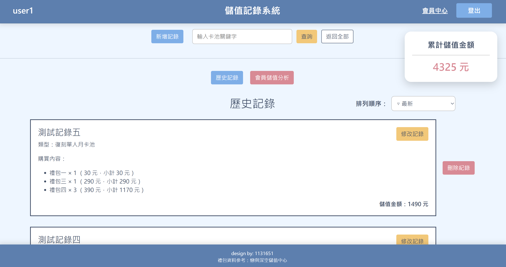
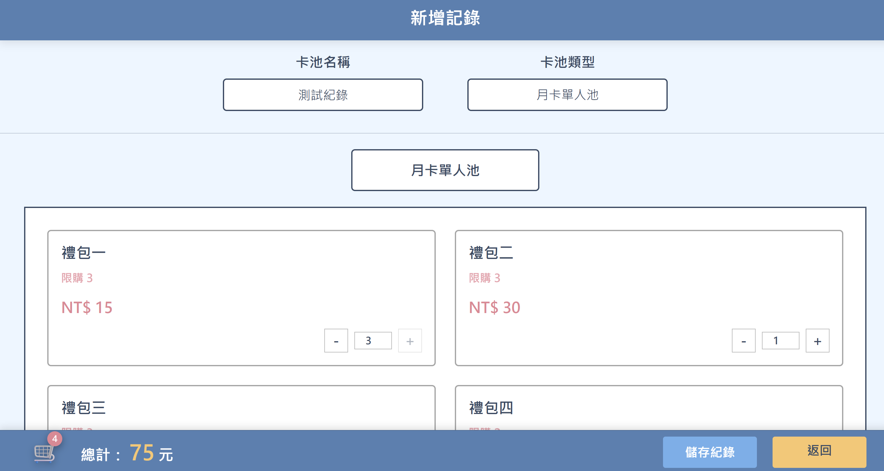
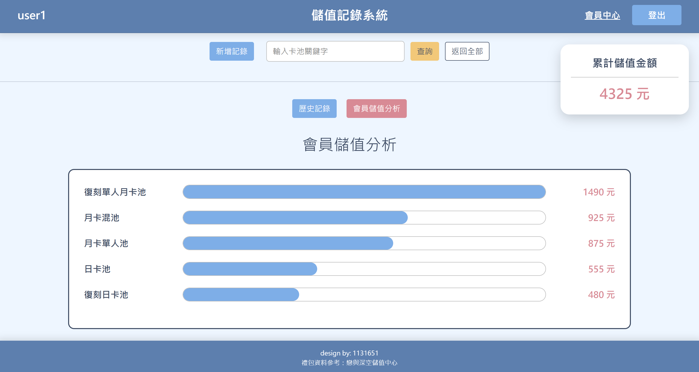
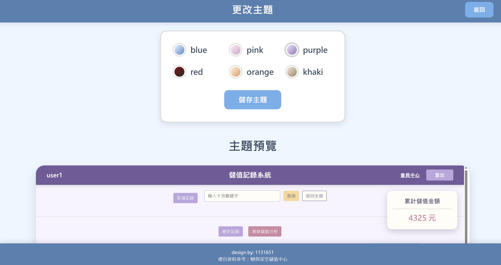
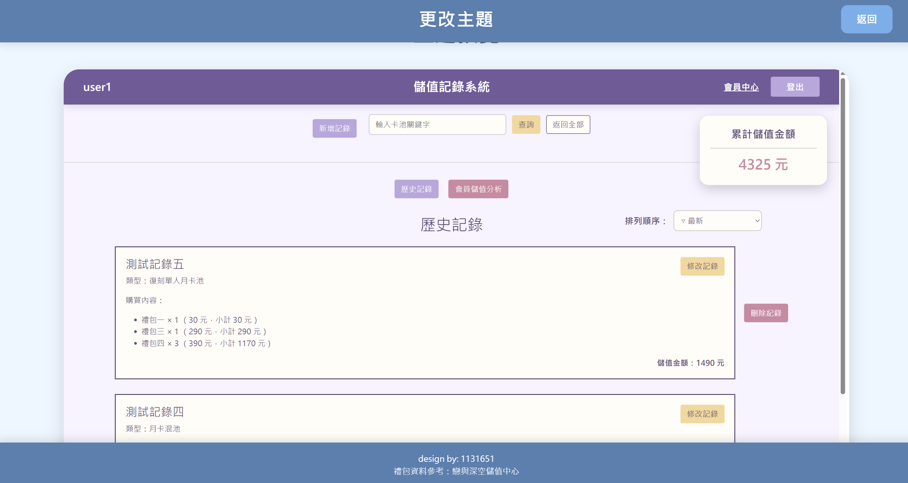

# 個人儲值記錄系統

## 一、專案簡介

本專案以「個人儲值記錄系統」為主題，使用 ASP.NET Core MVC、C# 與 SQL Server 開發一套提供遊戲玩家管理儲值紀錄的網頁系統。

使用者可依照不同的卡池類型選擇禮包及購買數量，由系統自動計算儲值金額，並將相關資料儲存至資料庫中。

除了基本的儲值紀錄管理，系統也整合會員管理、搜尋排序、分頁顯示、消費統計及個人化主題設定等功能。

### 開發動機

本專案從自身的興趣與使用需求出發。

在瀏覽遊戲相關社群時，我發現部分玩家會使用 Excel 記錄購買的禮包與儲值金額，但這種方式通常需要自行輸入資料及計算金額。

因此，我希望將遊戲中選購禮包的操作方式應用於儲值紀錄管理，讓使用者透過選擇禮包及數量，自動完成金額計算與紀錄儲存，減少手動整理資料的步驟。

## 二、開發技術

| 技術／工具 | 用途 |
|---|---|
| Visual Studio | 專案開發與除錯 |
| ASP.NET Core MVC | 網站架構與後端功能 |
| C# | 程式邏輯與資料處理 |
| HTML、CSS、JavaScript | 網頁介面與互動功能 |
| SQL Server | 資料儲存與管理 |
| Entity Framework Core | 資料庫存取 |
| Session | 會員登入狀態管理 |

## 三、主要功能

### 1. 會員管理

提供會員註冊、登入、登出、個人資料修改及會員註銷功能，並具備重複帳號檢查與註銷確認機制。

### 2. 儲值紀錄管理

使用者可新增、查詢、修改及刪除儲值紀錄。每筆紀錄包含卡池名稱、卡池類型、儲值金額、建立時間及禮包購買明細。

### 3. 禮包選購與金額計算

依照所選擇的卡池類型顯示對應禮包，提供購買數量調整及金額自動計算功能。

使用者也可以透過購物車查看各項禮包的數量與小計，確認後將選購結果儲存為一筆儲值紀錄。

### 4. 資料查詢與排序

提供卡池名稱關鍵字搜尋、建立時間與金額排序，以及分頁顯示功能，方便管理歷史紀錄。

### 5. 儲值統計分析

自動彙整會員的累計儲值金額，並依照不同卡池類型統計消費金額，以水平長條圖呈現各類型的消費情況。

### 6. 個人化主題設定

提供六種網站配色，使用者可先預覽不同主題的效果，再決定是否套用。

主題設定會儲存至資料庫並與會員帳號對應，讓使用者再次登入時仍能保留原本選擇的配色。

## 四、系統畫面展示

本影片展示個人儲值記錄系統的實際操作流程，包含主要功能及使用者介面。

[▶ 觀看系統操作 Demo（YouTube）](https://youtu.be/c0G5WDkrgSk?si=K66eUhIcsn9q8n6v)

### 1. 儲值紀錄首頁

集中呈現會員建立的儲值紀錄，包含卡池名稱、禮包購買明細及儲值金額，並提供紀錄管理與查詢功能。

### 2. 禮包選購與金額計算

使用者可依照卡池類型選擇禮包，透過數量調整按鈕設定購買數量，系統會自動計算儲值金額。

### 3. 儲值統計分析

依照不同卡池類型統計消費金額，並以水平長條圖呈現，方便使用者比較各類型的儲值情況。

### 4. 個人化主題設定

提供六種網站配色，使用者可在正式套用前預覽不同主題的效果，再儲存自己偏好的網站外觀。

**主題選擇與預覽畫面**

## 五、系統架構與資料庫設計

本系統採用 MVC（Model-View-Controller）架構，將資料模型、使用者介面與控制邏輯分開管理。

透過 Entity Framework Core 與 SQL Server 整合，完成會員資料、儲值紀錄、禮包明細及主題設定的儲存與讀取。

資料庫共規劃六張資料表：

1. 會員資料表
2. 儲值紀錄資料表
3. 儲值明細資料表
4. 卡池類型資料表
5. 禮包資料表
6. 會員主題設定資料表

各資料表透過識別欄位建立資料對應關係，支援系統的資料管理與統計功能。

## 六、開發挑戰與解決方法

### 1. 會員註銷與關聯資料處理

由於會員資訊、儲值紀錄、購買明細及主題設定分別儲存在不同資料表，因此刪除會員時，也需要一併處理相關資料。

開發過程中，我重新確認各資料表的對應關係，並調整資料刪除的處理順序，使系統能在會員註銷時清除對應的紀錄與設定。

### 2. 個人化主題功能

為了讓不同會員保留各自選擇的網站配色，我在原有資料庫中新增會員主題設定資料表，儲存會員與主題的對應關係。

在主題預覽功能方面，起初製作的預覽畫面與實際網站不完全一致，因此改用 iframe 載入實際的儲值紀錄首頁，搭配主題參數呈現不同配色的效果。

### 3. 儲值紀錄與金額計算

由於一筆儲值紀錄可能包含多種禮包，因此需要分別保存整筆紀錄及各項購買明細。

系統將儲值紀錄與禮包明細儲存在不同資料表，並在選購介面加入數量調整及金額計算功能。

修改既有紀錄時，也會帶入原本的選購數量，並依照調整後的內容重新計算金額。

## 七、專案學習與收穫

這是我第一次完成結合資料庫、能夠實際儲存與管理資料的網頁系統。

大一初次接觸 HTML 時，我便對網頁設計產生興趣，但當時完成的作品仍以靜態展示為主。直到後來學習 ASP.NET Core MVC 與資料庫相關技術，才有機會將原本的構想實際做出來。

本專案在程式撰寫、功能實作及問題排除方面使用了 AI 工具輔助，而系統的需求發想、功能規劃、操作流程與介面構想則由我主導，並透過手繪草圖整理設計方向。

開發過程中，我持續透過實際操作、測試及調整，讓系統功能逐步符合原先的規劃。

這次經驗讓我更加了解如何將使用需求轉換成具體的系統功能，也認識到自己仍需要持續加強程式撰寫與技術理解能力。

## 八、未來改善方向

- 加強會員密碼的儲存與驗證機制，提升資料安全性。
- 新增 Excel 匯出功能，方便備份與整理儲值紀錄。
- 擴充依月份或特定期間進行消費統計的功能。

## 九、完整系統設計文件

本專案另有完整的系統設計文件，包含功能說明、資料庫結構、系統畫面、開發挑戰及學習心得。

[查看完整系統設計文件（PDF）](個人儲值記錄系統.pdf)

